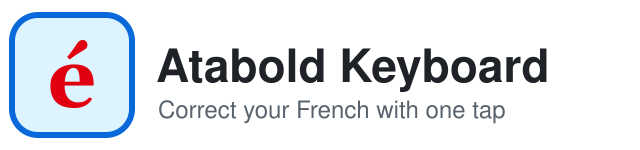
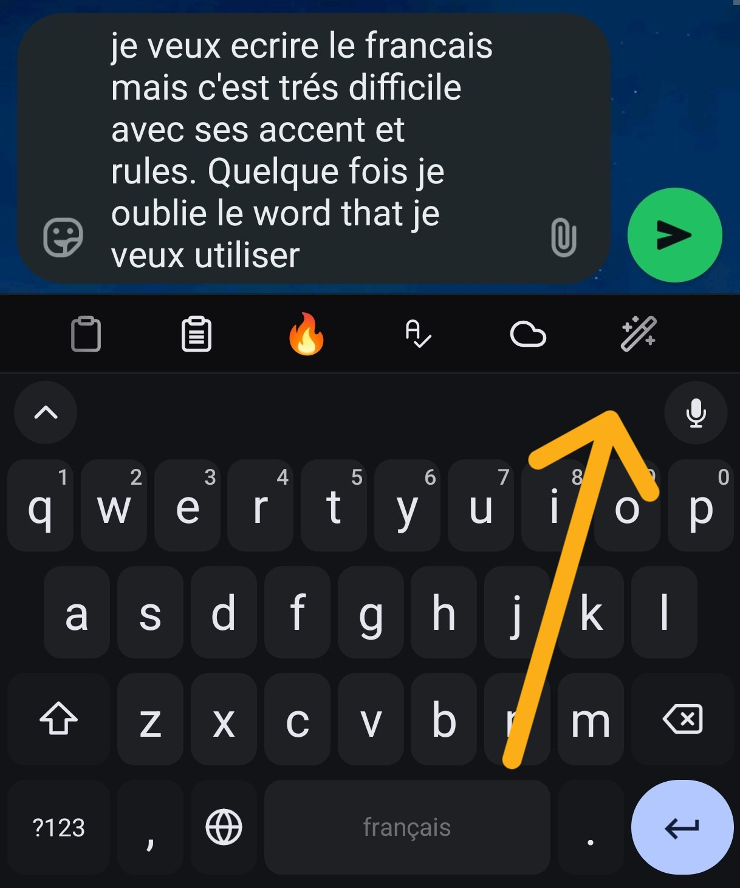
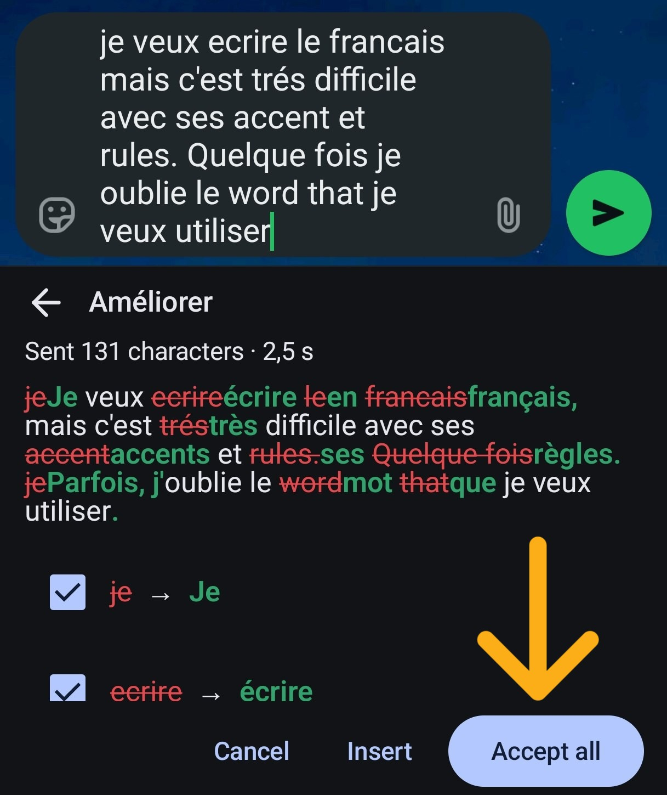
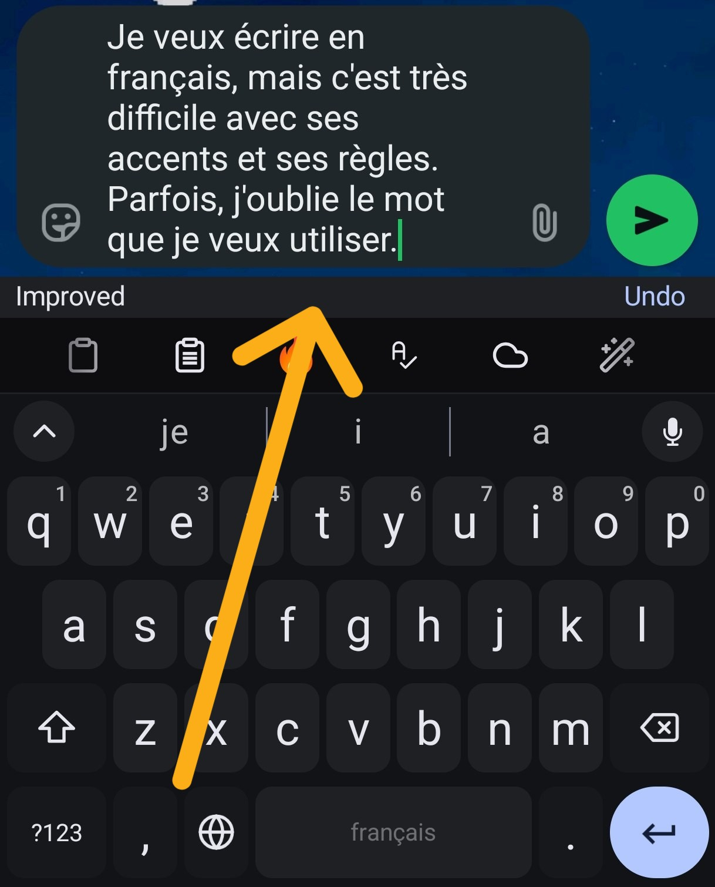
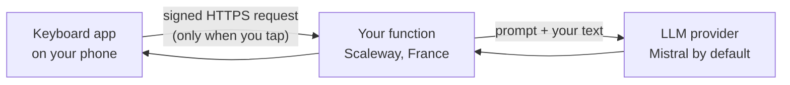

<p align="center">
  <picture>
    <source media="(prefers-color-scheme: dark)" srcset="docs/images/logo-dark.svg">
    
  </picture>
</p>

<p align="center">
  <b>An Android keyboard that corrects and improves your French with one tap, and tells you why.</b><br>
  Private by design: your text goes only to a backend that you host yourself. Nothing else leaves the phone.
</p>

<p align="center">
  <a href="LICENSE"></a>
  
  
</p>

<table align="center">
  <tr>
    <td align="center" valign="top"><br><sub><b>1.</b> Write as you always do</sub></td>
    <td align="center" valign="top"><br><sub><b>2.</b> Tap <i>Améliorer</i>: fixes and rephrasing, every change with its reason</sub></td>
    <td align="center" valign="top"><br><sub><b>3.</b> Insert it, or undo</sub></td>
  </tr>
</table>

> [!TIP]
> **Install it with an AI agent.** Open your coding agent (Claude Code, Codex, Gemini CLI, Cursor, ...) and paste this:
>
> ```text
> Clone https://github.com/Atabold/atabold-keyboard at tag v0.1.0 and follow INSTALL_WITH_AI.md.
> Ask me before any command that changes my machine, my accounts or my phone.
> I will type every secret myself and never paste one into this chat.
> ```
>
> The agent does the typing; you keep the secrets and approve each step. Read [what the agent will and will not do](INSTALL_WITH_AI.md) first. Prefer to do it by hand? Follow the [install guide](docs/guides/getting-started.md).

> [!NOTE]
> **A personal project.** I built this for myself, to write better French, and I share it as it is. It works out of the box for people who write **English, French, German, Spanish or Italian** and want to learn French: you write in any of them (other languages work where Mistral's models handle them), read the explanations in the language you pick when you install it, and use the app in English or Italian. Another language pair? [Ask for it](https://github.com/Atabold/atabold-keyboard/issues/new?template=adaptation_request.yml) and I may add it, or [adapt it yourself](docs/guides/adapt-to-your-language.md): the guide says which files to change and how to check the result. Support is best effort and there is no warranty.

## Two repositories: read this one first

| | **This repository** (start here) | The Android app |
|---|---|---|
| Repository | [atabold-keyboard](https://github.com/Atabold/atabold-keyboard) | [atabold-keyboard-android](https://github.com/Atabold/atabold-keyboard-android) |
| What is in it | the install guide, the backend (a Scaleway function), tools, the prompt evaluation, all the documentation | the keyboard itself: a **modified fork of [FUTO Keyboard](https://keyboard.futo.tech/)** |
| Licence | [GNU AGPL-3.0-or-later](LICENSE), open source | FUTO Source First License 1.1-kb, unchanged: FUTO's property, source-available |
| Updates from FUTO | – | **not guaranteed**, security fixes included: read its [UPSTREAM.md](https://github.com/Atabold/atabold-keyboard-android/blob/main/UPSTREAM.md) |

You only open the second repository when you build the app. This project is not affiliated with, endorsed by or supported by FUTO.

## Privacy matters

This project exists because I wanted help with my French without handing my messages to anyone.

1. **Typing, swipe, autocorrect and speech-to-text stay on the phone.** The keyboard engine and the speech-to-text models are FUTO's and run offline: your keystrokes and your voice never leave the device.
2. **Text is sent only when you tap an action**, and only to the backend you host. The one exception is the automatic formatting of dictation, which is off by default.
3. **Online features work only in a fixed list of apps**, never in password or code fields, and a sensitive-data check runs on the phone before anything is sent.
4. **Your text is not kept.** No backups, no logs in release builds, a clipboard history that lives in memory, sensitive items erased after 60 seconds. The only exception is FUTO's learning dictionary, which works only in the allowed apps.
5. **There is no central server.** Your function is yours and I never see your text. The LLM provider you choose does see it, so opt out of training there.

> [!IMPORTANT]
> The keyboard engine, the speech-to-text models and the payment screens come from FUTO Keyboard. I did not write, train or audit them, and I take no responsibility for them: they are provided as they are, under FUTO's licence and terms. What this project adds is described in [privacy](docs/guides/privacy.md) and in the [security model](docs/guides/security-model.md). None of it has been independently audited.

## What it does

You write normally, with FUTO Keyboard's swipe, autocorrect and offline dictation, all on the phone. When you want help, you tap an action on the toolbar:

| Action | What it does |
|---|---|
| **Corriger** | Fixes the mistakes and shows every change with the rule behind it. A word in another language inside a French sentence is translated. |
| **Améliorer** | Does the same, and also rephrases the text so it sounds natural, without leaving a grammar error behind. This is the one in the pictures above. |
| **Traduire** | Translates the text into French, English, German, Spanish or Italian. |
| **Format** | Adds punctuation and capitals to dictated text, and can do it automatically after dictation (off by default). |
| **Warm up** | Wakes your backend, so the next correction is fast. |
| **Online** | One switch for all online features. |

You accept or reject each change on its own, insert the result, and can undo it. English texts get American / British spelling notes instead of false errors. Put the actions you use on the toolbar, one tap away: [how](docs/guides/using-the-keyboard.md#put-the-actions-on-your-toolbar).

## Suggested settings

The defaults are already the setup I recommend. These are the few worth knowing, all in the keyboard's settings under *Correction & privacy* (no rebuild needed).

| Setting | Suggested | Why |
|---|---|---|
| Language of the explanations | **English** (the default), or your own language | each change comes with its reason in that language; the first-run default is the `explainIn` you chose at install, English if you did not choose |
| Profile | **Fast**; try *Accurate* if a correction looks wrong | in the evaluation both answered in about 0.9 s and passed almost the same checks; *Accurate* is the larger model, so it costs more per request |
| Explanations | **Short** | one sentence per change; *Detailed* adds the rule and an example when you want to learn it |
| Insertion | **Show the changes** | you see every change and untick what you do not want; *Replace at once* is for when you trust the result |
| Language of the result | **The main language of the text** | write in your language or in French and each text is corrected in its own language; *Always French* turns everything into French |
| Toolbar | pin **Améliorer**; Corriger, Traduire and Format as favorites | one tap, without opening *All Actions*: [how](docs/guides/using-the-keyboard.md#put-the-actions-on-your-toolbar) |
| Warm up | tap it before a long writing session | the first request after a pause can take a few seconds |

Every setting and its default: [Customise](docs/guides/customize.md#level-1-the-settings).

## How it works



The prompts live on your function, not in the app. Every request is signed by a key that never leaves your phone's secure hardware, so only your phone can use your backend. [How a request travels, step by step](docs/guides/how-it-works.md).

## Is this for you?

| | |
|---|---|
| ✅ | You write in English, French, German, Spanish or Italian (for other languages, take a look at the following section) and want to learn French. |
| ✅ | You want to control your accounts, your keys and your spend cap. |
| ⚠️ | You build the APK yourself and register your phone by hand: that is the security model, not an oversight. Plan about an hour of work and a build of 10 to 20 minutes. |
| ⚠️ | It was tested on one phone and has not been independently audited. Most of the code and the documentation were written with an AI coding assistant (Claude Code); the design decisions are the author's. |
| ❌ | You want an app-store install, an iPhone version, or a hosted service. |
| ❌ | You want to sell the Android app or ship it commercially: FUTO's licence does not allow it. |

## Customise it

| I want to... | Read |
|---|---|
| change a setting, an allowed app or a model | [Customise](docs/guides/customize.md) |
| use another language pair or interface language | [Adapt it to your language](docs/guides/adapt-to-your-language.md) |
| use another LLM provider, or opt out of training | [Choose your LLM provider](docs/guides/choose-your-llm-provider.md) |

## Documentation

| | |
|---|---|
| [Install guide](docs/guides/getting-started.md) | Accounts, backend, build, install, register your phone. |
| [Install with an AI agent](INSTALL_WITH_AI.md) | The same, as a runbook for an agent and the person supervising it. |
| [Using the keyboard](docs/guides/using-the-keyboard.md) | The actions, the panel, why an action is locked. |
| [Troubleshooting](docs/guides/troubleshooting.md) | Every message the app can show, and install problems. |
| [Developer reference](docs/README.md) | Architecture and the design specification. |

## Licences

| Part | Licence |
|---|---|
| This repository: backend, tools, prompts, evaluation set, documentation | [GNU AGPL-3.0-or-later](LICENSE), **open source** |
| The Android app (the other repository) | FUTO Source First License 1.1-kb, unchanged, **source-available**: FUTO's property |
| The files I wrote from scratch for the app | also available under the AGPL: see [LICENSING.md](https://github.com/Atabold/atabold-keyboard-android/blob/main/LICENSING.md) |
| Icons, AOSP code and the rest | [THIRD_PARTY_NOTICES.md](THIRD_PARTY_NOTICES.md) |

Copyright (C) 2026 Atabold. In plain words, and not as legal advice:

- **This repository** is free software under the GNU Affero General Public License, version 3 or (at your option) any later version. You may use, study, change and share it, and even sell it, as long as your versions stay under the AGPL. If you run a modified version as a service for other people, you must offer them its source. Running your own copy for yourself asks nothing more of you.
- **The Android app** is built on FUTO Keyboard, which belongs to FUTO. Their licence lets you use it for any purpose, but you may modify and share it only for non-commercial purposes and free of charge, and you must keep FUTO's notices and payment screens. Only FUTO can change those terms, so the app cannot be AGPL, and it is not open source in the usual sense.
- The name and the logo are not licensed for promoting other products.

## Supporting the project

I do not take money for this, and I do not want to. If you find it useful, the best support is to **share the repository** with someone who is learning French, and to **tell me how to improve it**: [ideas and feedback](https://github.com/Atabold/atabold-keyboard/discussions) are very welcome.

FUTO Keyboard, which the app is built on, has its own payment screens ("Pay for FUTO Keyboard"). They are FUTO's, they stay in the app because FUTO's licence requires it, and **I receive no share of anything paid there**. A card at the top of the payment screen says exactly that, and who made this version.

## Contributing and security

- Bugs, questions and ideas: [CONTRIBUTING.md](CONTRIBUTING.md). Please never paste your own text, URLs or keys in a public issue.
- A vulnerability or a possible leak of text: do not open an issue; follow [SECURITY.md](SECURITY.md) to report it privately.
- Changes: [CHANGELOG.md](CHANGELOG.md).

## Thank you, FUTO

This project stands on **FUTO Keyboard**. The keyboard engine, the swipe, the autocorrect, the offline speech-to-text and the payment screens are the work and the property of [FUTO Holdings, Inc.](https://keyboard.futo.tech/), used under their licence. What I wrote is the backend and the modifications described here: the online actions, the privacy rules, the signed requests, and this name and icon. Thank you, FUTO, for building a keyboard that stays offline and does not spy on you, and for sharing its source.

If you want to support the keyboard itself, do it through FUTO: payments made in the app go to them, not to me. You can find me, the author of this version, at [github.com/Atabold](https://github.com/Atabold).

Thanks also to the Android Open Source Project, to [Lucide](https://lucide.dev/) for the toolbar icons, and to the services this runs on, Mistral AI and Scaleway.

Not affiliated with FUTO, Mistral AI, Scaleway, Telegram or any app named in the documentation. Product names belong to their owners.
