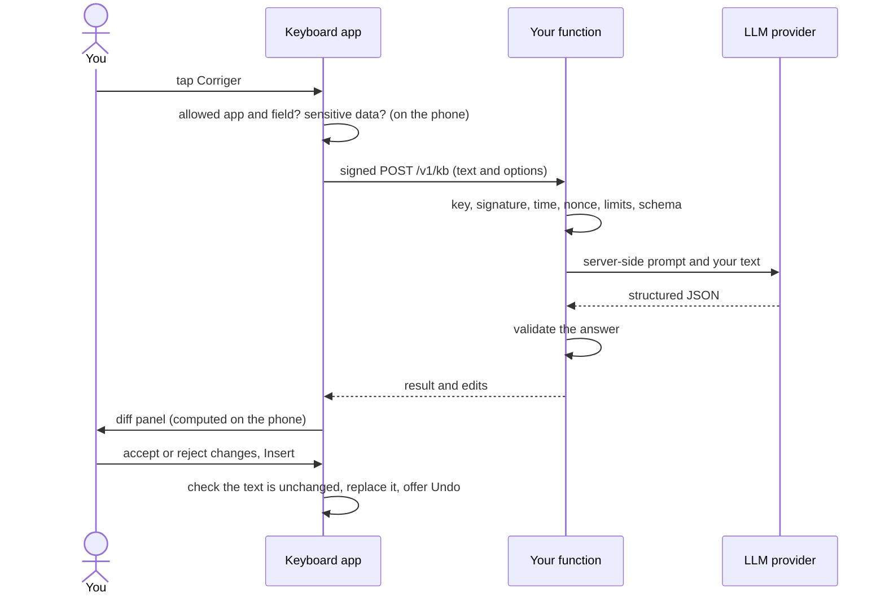

# How it works

The short version is in the [README](../../README.md#how-it-works). This page follows one request from your thumb to the screen and back, then explains the decisions behind it. The detailed, current-state references are [the Android fork](../architecture/android-fork.md) and [the backend](../architecture/backend.md).

## The parts

| Part | Where it runs | What it does |
|---|---|---|
| **The keyboard app** | your phone | FUTO Keyboard with swipe, local autocorrect and offline dictation, plus this project's additions: the toolbar actions, the privacy rules, the sensitive-data check, the signed client, the diff panel. |
| **Your function** | Scaleway Serverless Functions, in France | Checks the signature and the limits, holds the prompts, calls the LLM, validates the answer. Stores nothing. |
| **The LLM provider** | Mistral by default | Does the actual correction. Sees the text you send. |
| **Telegram** (optional) | Telegram's servers | Receives fixed-text alerts from the function. Never your text. |

There is no server operated by this project. Everything you deploy is yours.

## One request, step by step

**On the phone, before anything is sent** (the *online gate* and the *checks before sending*):

1. The app and the field are looked up in the fixed privacy rules. Not an allowed app, a password or code field, an incognito field, an always-blocked app: the action stays locked and says why.
2. Online features must be on, the integrity checks must pass (your signing certificate, a non-debug build, the device key in secure hardware), "Wi-Fi only" must be satisfied, and the field must not hold a sensitive text you pasted.
3. The text to send is chosen. In chat, social and chatbot apps it is the whole field. In email and document apps it is the selection if there is one, otherwise the whole field. Over the character limit, the action refuses; it never truncates.
4. The sensitive-data check looks for payment cards, IBANs, secrets and API keys, tax and national ID numbers, one-time codes, emails and phone numbers. For each kind you chose to block, ask or ignore. Only the kind is ever shown, never the value.

**The request.** A `POST` to `/v1/kb` with a JSON body: `action` (`correct`, `improve`, `translate` or `format`), `text`, and `options` (languages, register, detail, profile...). It is signed with an EC P-256 key that lives in the Android Keystore (secure hardware, not exportable). The signed string is `v1`, the method, the path, a timestamp, a random nonce and the SHA-256 of the body.

**On your function**, in this order, rejecting at the first failure:

1. the key id must be the registered one, then the signature must verify;
2. the timestamp must be within 30 seconds, and the nonce must not have been seen in the last 60 seconds (that is what stops a replay);
3. `/v1/ping` stops here with `204` and costs nothing;
4. the daily cap (300) and the per-minute limit (20);
5. the body must be at most 16 KB and match the strict schema: only the known fields, only the allowed values, text of 1 to 4,000 characters;
6. the prompt for the action is read from the function's own files and the call goes to the provider with a JSON schema the answer must follow; one retry if the answer is invalid, and both attempts share a 15-second deadline;
7. the answer is validated again: non-empty result, not longer than 3 times the input plus 200 characters, well-formed edits, unknown categories mapped to `vocabulary`.

Errors are always a bare `{ "error": "<code>" }`. Anything that looks like an attack or a problem (an unknown key or a bad signature, a replay, the daily limit being reached, the provider answering 429 because its budget ran out) sends you a Telegram alert, at most one per kind every 15 minutes.

**Back on the phone.** The differences between your text and the result are computed word by word on the phone, and each explanation is attached to the change it describes. You accept or reject changes one by one, or accept everything. Before inserting, the app re-reads the range it sent; if the text changed in the meantime it inserts nothing. The original is kept in memory only so that **Undo** works, until you move to another field.

## What the model is asked

The prompts are plain text files in [backend/prompts/](../../backend/prompts/), one per action. The phone never sends prompt text, only options from fixed lists, and the user's text is passed as data with the instruction to ignore any instruction inside it. The rules are the same ones you see in the product: minimum edits, no rephrasing of correct text, names, brands, URLs, emoji, code and numbers untouched, a word in another language translated, American and British English both accepted. The answer must follow a JSON schema with the detected language first (so the model commits to the language before writing the result), the corrected text, a list of edits with a category and an explanation in your chosen language, and a list of notes.

## Dictation and automatic formatting

Dictation is FUTO's offline speech recognition: the audio never leaves the phone. With *Format dictation automatically* on, the dictated text (and only that) is sent to your function before it is inserted, with an 8-second limit. On an error, on a timeout, or when sensitive data is found, the text goes in exactly as dictated and a notice says so. After formatting, an *Undo* puts back what you dictated. This is the only request the app ever makes without a tap, and it is off by default.

## Cold start, Warm up and limits

With `min-scale=0` the function sleeps after about 15 minutes without a request, so the first request after a pause takes a few seconds. **Warm up** sends one signed `/v1/ping` (no text, not counted in the limits) and keeps the function awake for roughly the next 15 minutes. There are no automatic or periodic pings. The limits live in memory and reset on a cold start, which is accepted: the real ceilings are the provider's spend cap and `max-scale=1`.

## Where things are

| Path | What |
|---|---|
| [backend/](../../backend/) | the function: `handler`, `auth`, `limits`, `schema`, `mistral`, `alerts`, `config`, its prompts and its tests |
| [tools/](../../tools/) | a development key and signed test requests, and the script that registers your phone |
| [eval/](../../eval/) | test sentences and the script that runs them through both profiles |
| [docs/](../README.md) | guides, architecture and the design specification |
| `android/` | the keyboard, in [its own repository](https://github.com/Atabold/atabold-keyboard-android); the project's code is in the package `org.futo.inputmethod.latin.kbfr` |

## Decisions worth knowing

- **The LLM runs only when you tap.** There is no live correction while you type. That keeps the cost, the battery use and the amount of text leaving the phone small, and it keeps you in charge.
- **The function is public, but useless without your key.** A private Scaleway function would need a Scaleway key on the phone. Instead the phone holds a hardware-bound signing key, and the function rejects everything else within milliseconds.
- **The backend address is compiled in.** An editable address would let anyone with your unlocked phone for a few seconds, or a settings backup prepared by someone else, point the keyboard at another server that could forward your signed requests.
- **No provider key on the phone.** The most a stolen phone key can do is spend your provider's monthly cap, and only through your function.
- **Rules that protect you are in the code, not in the settings.** Changing which apps may use online features means rebuilding and re-signing the app. See [security model](security-model.md).
