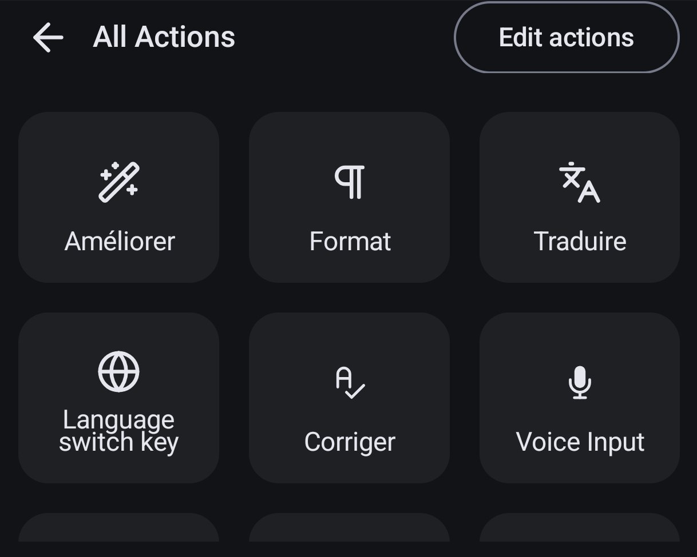
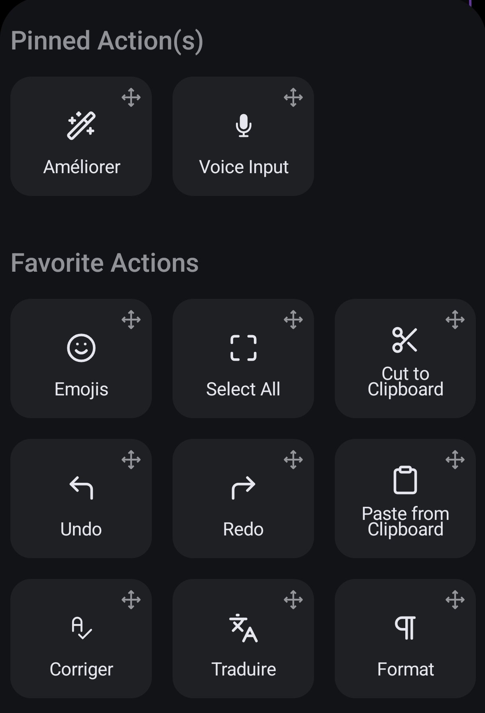

# Using the keyboard

How the keyboard behaves day to day. The screenshots are in the [README](../../README.md); the messages quoted here are the ones in the English interface (the Italian interface says the same in Italian).

Typing, swipe, autocorrect and dictation are FUTO Keyboard's and work offline, in every app. Everything below is about the online actions, which only work where [the privacy rules](privacy.md#the-rules-written-into-the-code) allow.

## The toolbar

| Action | When to use it |
|---|---|
| **Corriger** | You wrote something and want to know what is wrong with it. Fixes mistakes only; correct text is left alone. |
| **Améliorer** | You want it to sound natural. Does what Corriger does, and also rephrases. Rephrasings are marked as *Style*. |
| **Traduire** | You want the whole text in French, English, German, Spanish or Italian (you choose in the settings). |
| **Format** | You dictated, and you want punctuation, capitals and paragraphs, and fillers removed. |
| **Warm up** | You are about to write for a while and the backend has been idle. |
| **Online** | One switch for all online features. Off means nothing is ever sent. |

The action names Corriger, Améliorer and Traduire stay in French in every language on purpose. New actions start in *All Actions*: [put the ones you use on the toolbar](#put-the-actions-on-your-toolbar).

## Put the actions on your toolbar

New actions start in *All Actions*. To have the ones you use one tap away, move them to the toolbar once. It is FUTO's action editor, and the changes are saved when you leave it.

1. In any text field, tap the **>** button on the suggestion bar to open the action bar, then the **⋯** button (*All Actions*). You can already tap Corriger, Améliorer, Traduire, Format, Warm up and Online from there.

   
2. Tap **Edit actions** at the top of that panel. (The same editor is in the keyboard's settings: *Actions*, then *Edit Actions*.)
3. Press and hold an action, then drag it into a section:
   - **Pinned Action(s)**: always visible next to the suggestions; two or three at most.
   - **Favorite Actions**: on the action bar that the **>** button opens.
   - **Action Key**: the key next to the space bar; one action only.
   - **More Actions** and **Hidden Actions**: where the rest stay.

   
4. Leave the editor. The actions stay where you put them.

A layout that works well: pin **Améliorer** next to the microphone, put **Corriger**, **Traduire** and **Format** under Favorite Actions, and leave **Warm up** and **Online** in More Actions: tap Warm up there before a long writing session.

## Which text is sent

- In **messaging, social and chatbot apps**: the whole field, that is, the message you have not sent yet. A selection is ignored.
- In **email and document apps**: the **selection**, if there is one, otherwise the whole field. Select a paragraph to work on a long document in parts.
- Over the character limit (4,000 by default, you can lower it) the action refuses: *Text too long (max N characters)*, or in email and documents *Select a part (max N characters)*. It never cuts your text.

## Corriger, step by step

1. Write in the field. Mistakes are fine.
2. Tap **Corriger**. The panel replaces the keyboard and says *Sending N characters…*.
3. After a second or two it says *Sent N characters · 1.4 s* and shows your text with the changes:
   - words taken out are red and struck through, words put in are green;
   - below, one row per change with a **checkbox** (ticked), the category (*Elision*, *Past participle agreement*, *False friend*, *Translation*, *Style*...) and the explanation in the language you chose;
   - *Other explanations* lists any explanation the app could not tie to a visible change;
   - for English text, *Notes (American / British English)* lists words of the other variety. Their boxes start **unticked**: tick one if you want that word changed.
4. Untick the changes you do not want. Then **Insert** (only the ticked changes), **Accept all** (the whole result at once) or **Close** (nothing).
5. The text is replaced, and a strip above the toolbar says *Corrected · Undo*. **Undo** restores your original until you move to another field. If the text changed between sending and inserting, nothing is replaced and the app says *Text changed in the meantime*.

If there is nothing to fix you get *No errors found*. If you set *Insertion* to *Replace at once (with Undo)* in the settings, step 4 is skipped and the result goes in immediately.

A word in another language inside a French sentence counts as a mistake of kind *Translation*: it is translated and the rest of the sentence is corrected as usual. Names, brands, links, emails, @mentions, #hashtags, emoji, code and numbers are left alone.

## Améliorer, Traduire, Format

They use the same panel and the same safety checks.

- **Améliorer** adds *Style* changes, each with its own checkbox, and promises that a rephrasing never leaves a grammar error behind. The strip says *Improved*.
- **Traduire** always shows the panel, with the translation only, and *Insert* / *Close*. The strip says *Translated*.
- **Format** always shows the panel. Punctuation, capitals, paragraph breaks (shown as ¶) and removed fillers are changes without an explanation; transcription fixes have one. The strip says *Formatted*.

## Warm up

Your function sleeps when idle, so the first request after a pause can take several seconds. **Warm up** sends one tiny signed request that carries no text: the icon turns into a clock while it runs and shows ✅ for two seconds when the backend answered. For about 15 minutes after that, requests do not pay the start-up cost. There is no automatic warming: tapping is the only trigger.

## Why an action is locked

A locked action is dimmed with a padlock. Tap it and a line above the toolbar says why.

| Message | Meaning |
|---|---|
| *App not allowed* | Online features and learning only work in the apps on the [allowed list](customize.md#the-allowed-apps). Browsers are not on it. Everywhere else the keyboard still types, swipes and autocorrects, but learns and sends nothing. |
| *App always blocked* | Password managers and authenticator apps. Never, whatever the list says. |
| *Password or code field* | Password, PIN, number, phone and date fields. |
| *Incognito mode* | The app asked keyboards not to learn. |
| *Online features off* | The *Online* switch is off. |
| *Integrity compromised* | A check failed: the APK is not signed with your key, it is a debug build, or the device key is not in secure hardware. A red banner stays on until it is fixed. |
| *Wi-Fi only: not connected to Wi-Fi* | You turned on *Wi-Fi only* in the settings. |
| *Sensitive data pasted in this field* | You pasted a code or secret from the keyboard's clipboard into this field. Online features stay off while it contains that text; emptying the field lifts the lock. |

## Before anything is sent

The sensitive-data check runs on the phone. For each kind of data (payment card, IBAN, secret or API key, tax or national ID number, one-time code, email, phone number) the settings say **Block**, **Ask** or **Ignore**. Block: nothing is sent, and the line says *Not sent, sensitive data: …* with the kind but never the value. Ask: the panel opens on *Send N characters?* with the kinds found, and sends only after you tap **Send**. The check recognises known key prefixes and random-looking strings; it does not recognise a password you made up from words, so it is a safety net, not a guarantee. You can also ask for a confirmation before every send, or above a number of characters.

## Dictation

Offline, FUTO's. With *Format dictation automatically* on (off by default), the dictated text is sent, formatted and inserted, with *Formatting…* on screen for up to 8 seconds. If anything goes wrong or sensitive data is found, the text goes in as dictated, with a notice. The strip *Formatted · Undo* puts back the raw dictation. A transcription model writes punctuation itself, so unformatted dictation can look formatted: the strip is the reliable sign that formatting happened.

## The clipboard

The clipboard history lives in memory only and disappears when the keyboard process ends. Images and screenshots are ignored. Anything that looks like a one-time code or a secret, or that you copied in a password field or from a blocked app, is shown as `••••••`, pasted with one tap, and **removed after 60 seconds** (the system clipboard is cleared too when it still holds it). The 60 seconds count while the phone is awake.

## Errors you may see

Every message and what to do about it: [troubleshooting](troubleshooting.md#messages-in-the-app).

## The settings

*Correction & privacy* in the keyboard's settings: connection (backend address, read-only; device key; timeout; Wi-Fi only; test), privacy (online switch, character limit, confirmations, the sensitive-data rules, the fixed lists of apps), Corriger / Améliorer (explanation language, result language, translate other-language words, tu/vous, detail, profile (fast or accurate), American/British harmonising, insertion mode), Traduire (target language), Voice / Format, Security (the three integrity checks), and *About this fork*. What each one does and how to change what the settings cannot: [customise](customize.md).
